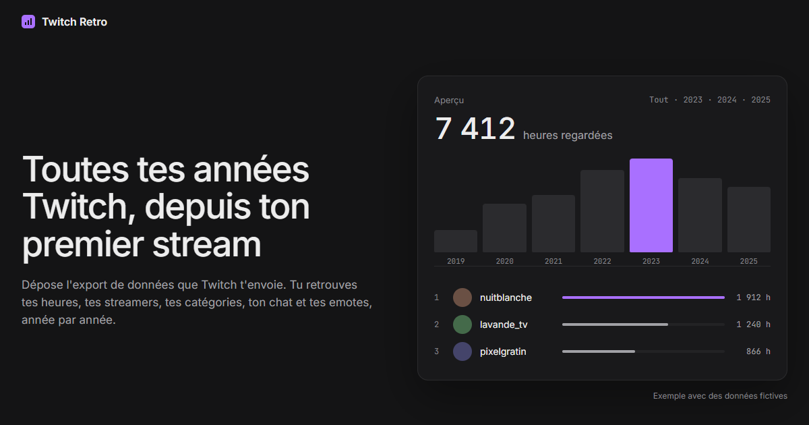

# Twitch Retro

An all-time Twitch retrospective built from the data export Twitch sends
you (the `request-*.zip` file), in French and English. Live at
[twitchretro.7ibo.dev](https://twitchretro.7ibo.dev).



Every year since your first stream: hours watched, streamers, categories, a
calendar, chat and emotes (Twitch, 7TV, BetterTTV, FrankerFaceZ), follows,
subs and ads, your own channel, and PNG cards to share. Filters by year and
month, a page per streamer and per category.

Not affiliated with Twitch.

## Privacy

Everything is computed in the browser: the zip is read in a Web Worker and is
never sent to a server.

- Only these files of the zip are decompressed: `metadata.json`,
  `login_rename.csv`, `minute_watched.csv`, `video_play.csv`,
  `chat_messages.csv`, `minute_broadcast.csv`, the follow files, the subs,
  the bits, `vod_create.csv`, `video_ad_impression.csv` (date and channel of
  each ad) and `users/user/<id>.json`, of which only the `displayname` field
  is read with a pattern: the email and phone number it holds are never
  parsed. The other files (security, page views, other ads…) stay
  compressed.
- In the files that are read, only the needed columns are extracted
  (`src/lib/csv.ts`): IP, city, country, device and browser never become
  JavaScript strings.
- For avatars, box art and emotes, the ids of the channels you watched,
  followed or chatted in, game names and watched VOD ids go to the site's
  own `/api/enrich`, which asks Twitch, 7TV, BetterTTV and FrankerFaceZ and
  keeps nothing. A box on the landing page turns this off.
- The built site carries a Content Security Policy that forbids any network
  call except its own API and images from the public CDNs of Twitch, 7TV,
  BetterTTV and FrankerFaceZ. No cookie, no analytics.

The full policy is on the site, under "Privacy".

## Run it

Needs Node 24 (and Bun for the checks).

```sh
npm install
npm run dev        # http://localhost:5173, /api/* served by vite.config.ts
npm run build      # types and production build in dist/
npm run check:all  # text checks and tests (Bun)
```

Images need a Twitch application: create one at
[dev.twitch.tv/console](https://dev.twitch.tv/console) and put its
`TWITCH_CLIENT_ID` and `TWITCH_CLIENT_SECRET` in `.env.local` (see
`.env.example`). Without them the site still works, without avatars, Twitch
emotes or box art of recent categories.

To host your own copy, any static host works for `dist/`; the two functions
in `api/` are written for Vercel and take the same two variables.

## How it is built

Svelte 5 and Vite, no framework router (hash routes), `fflate` to unzip in a
Web Worker. `CLAUDE.md` describes the code, the quirks of the Twitch export
and the conventions; `docs/` holds the design direction and the rules the
repository follows.

## Contributing

This is a small side project, not a product with a roadmap. Issues and pull
requests are welcome; security reports go by email (see `SECURITY.md`).

## License

[MIT](LICENSE). Twitch is a trademark of Twitch Interactive, Inc.; the
avatars, box art, badges and emotes shown by the site belong to their
creators.
